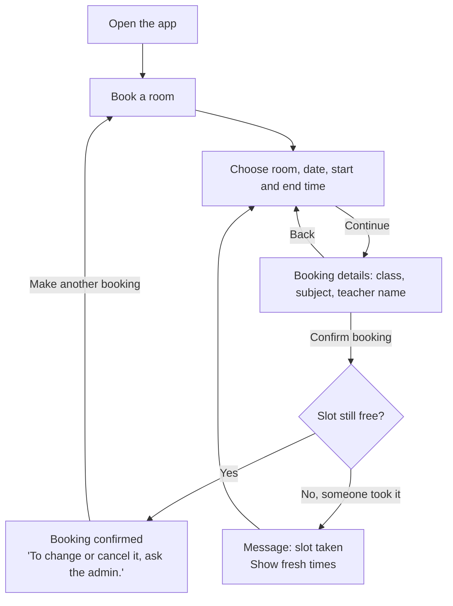
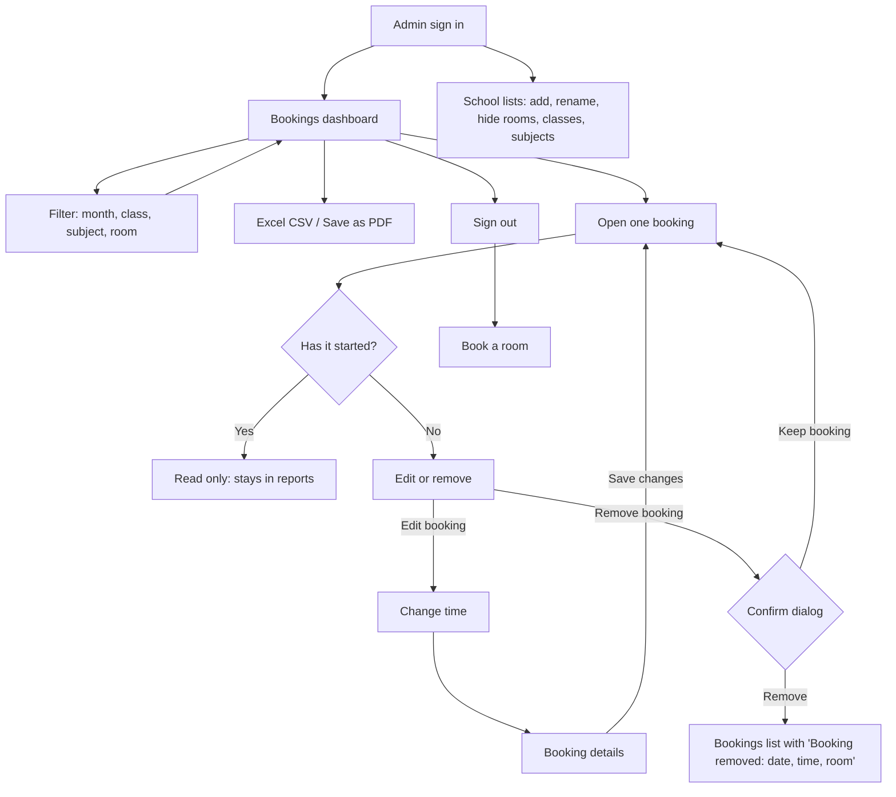
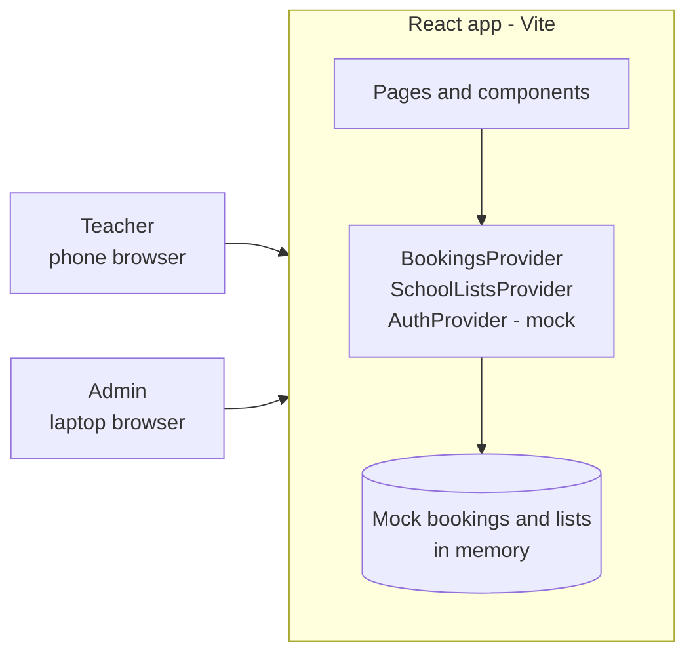
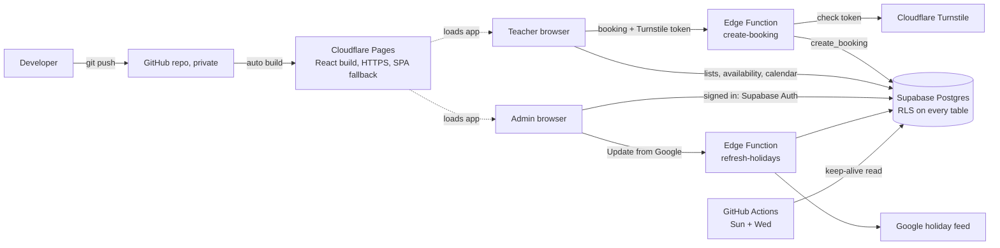
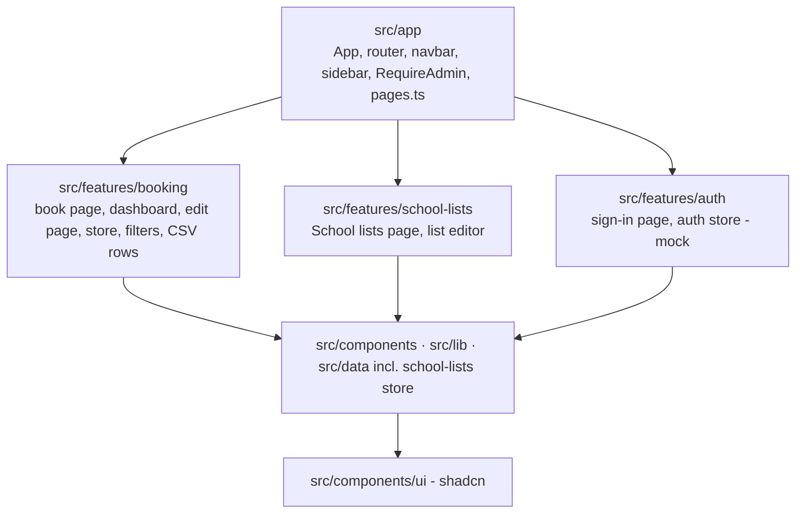
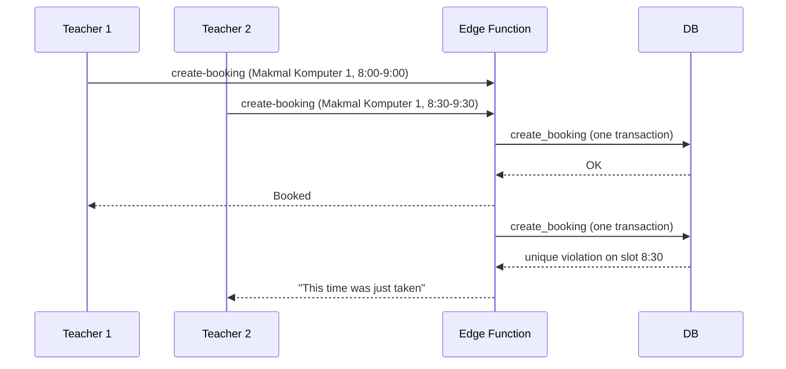

# Architecture — MITSPI Room Booking

High-level design: who uses the app, the flows, the system parts, the API and security.
The database is in [database.md](database.md).

Status: the frontend flow is built (UI only, mock data). The backend is a plan:
Cloudflare Pages + Supabase (decided 21 Oct 2026). Spring Boot is no longer in the plan.

## 1. Requirements (from the school, 20 Oct 2026)

| # | Question | Answer |
|---|---|---|
| 1 | Who books? | Teachers only. Students do not use the app. |
| 2 | Do teachers log in? | No. |
| 3 | Can a booking be edited or removed? | Only by the admin. A teacher who needs a change asks the admin. |
| 4 | Who sees the dashboard and downloads reports? | The admin only. |
| 5 | How many users? | One admin account for now, made by the developer. No sign-up page. More admins later = more Supabase Auth users plus rows in `admin_user`. |
| 6 | Who keeps school holidays (cuti sekolah) up to date? | The admin, on "Holidays and events". |
| 7 | Block weekends or holidays? | No. Only show a note (weekend, public holiday, school holiday, event). |

## 2. Roles and permissions

| Action | Teacher (no login) | Admin (signs in) |
|---|---|---|
| See free and booked times | Yes, and who booked (tap a booked time) | Yes |
| See public holidays (national + Selangor) | Yes | Yes |
| Book a room | Yes | Yes |
| See the dashboard (all bookings, names) | No | Yes |
| Download CSV, print to PDF | No | Yes |
| Edit a booking (time, room, details) | No — ask the admin | Yes, until it starts |
| Remove a booking | No — ask the admin | Yes, after a confirm dialog, until it starts |
| Add, rename or hide rooms, classes, subjects | No | Yes ("School lists") |

Rule: the server checks every row of this table. The browser only hides buttons.

## 3. User flows

### Teacher: book a room



The "Slot still free?" check happens on the server (later). Today the demo always says yes.

### Admin: manage bookings



An admin page opened while signed out goes to sign-in first, then back to that page.

**Hide, not delete:** a hidden room, class or subject leaves the booking form,
but old bookings and the filters keep it. At least one item in each list stays in use.

### Telling the teacher about a change (plan, not built)

The app stores no teacher phone numbers: a phone number is personal data
(Malaysia PDPA 2010). Options, simplest first:

| Option | How it works | Needs |
|---|---|---|
| A. "Send on WhatsApp" button (recommended first) | After an edit or remove, the admin taps the button. WhatsApp opens with a ready message (a `wa.me` link with the text). The admin picks the teacher from their own contacts. | Nothing stored. No cost. No bot. |
| B. WhatsApp bot (WhatsApp Business Platform, Cloud API) | The server sends the message by itself. | Each teacher's number and consent, Meta business verification, approved message templates, a cost per message, secure storage and opt-out. |
| C. Email | The server emails the teacher. | Each teacher's school email. |

Start with A. Choose B only if the school wants automatic messages and agrees to store numbers.

### Holidays and events (built, information only)

The date picker marks a holiday or event with a dot. A picked day shows a note, for example
"Public holiday: Diwali" or "School holiday: Cuti Penggal 3", then "You can still book."
Booking is never blocked: the school's decision (20 Oct 2026). A Saturday or Sunday also gets a note: "Weekend: Saturday".

Three kinds, one list (`src/data/school-calendar.tsx`):

| Kind | Where it comes from | Who changes it |
|---|---|---|
| Public holiday | Google's public Malaysia holiday calendar: national + Selangor, plus Hari Keputeraan Sultan Selangor (11 Dec), which the feed does not have | Admin: "Update from Google" button. Developer: `node scripts/fetch-holidays.mjs` for the starting list |
| School holiday (cuti) | Typed by the admin; one day or a range | Admin: add, change, remove |
| Event | Typed by the admin; one day or a range | Admin: add, change, remove |

| Part | Today (demo) | Later |
|---|---|---|
| Feed source | Google ICS feed, no API key. Free APIs checked on 20 Oct 2026: Nager.Date and OpenHolidays have no Malaysia data. | Same |
| Filter rules | `src/lib/holiday-feed.ts`, shared by the script and the button | The server uses the same rules |
| "Update from Google" | The browser cannot read the feed (no CORS), so the Vite dev server forwards `/holiday-feed`. Works only with `npm run dev`. | Edge Function `refresh-holidays`: fetches the fixed feed URL and replaces the public holidays |
| Starting list | `src/data/holidays.json` (from the script, committed) | The database |
| Accuracy | Islamic dates are estimates until announced. Check against the official list (Prime Minister's Department). | Same |

## 4. System architecture

### Now: UI-only MVP



Data resets when the page reloads. The admin sign-in accepts any password.

### Later: Cloudflare Pages + Supabase (decided 21 Oct 2026)

All parts are on free plans. No server to set up or keep running.



| Part | Job |
|---|---|
| GitHub (private repo) | Keeps the code. A push to `main` starts a deploy. Runs the keep-alive job. |
| Cloudflare Pages | Serves the React build. HTTPS, CDN and DDoS protection are built in. |
| Cloudflare Turnstile | Checks that a person, not a script, sends the booking form. |
| Supabase Database (Postgres) | All data. RLS (row level security) rules decide who may read or write each row. |
| Supabase Auth | Admin sign-in (email + password). Replaces the mock. Sign-ups are turned off. |
| Supabase Edge Functions | `create-booking` (checks Turnstile, then saves) and `refresh-holidays`. |

Only the store files in the frontend change (`bookings-store.tsx`, `school-lists.tsx`,
`school-calendar.tsx`, `auth-store.tsx`). They call Supabase instead of React state. The pages stay the same.

#### Free plan limits (checked 21 Oct 2026; check again before launch)

| Service | Limit | What it means for us |
|---|---|---|
| Cloudflare Pages | Unlimited bandwidth, 500 builds a month | More than enough |
| Supabase | 500 MB database, 2 projects, 500,000 Edge Function calls a month | Years of bookings fit |
| Supabase | **Pauses after 7 days of low activity.** Restore from the dashboard within 90 days. | Keep-alive job (below) |
| Supabase | **No automatic backups** on the free plan | The admin downloads the CSV each month |
| GitHub Actions | Scheduled jobs in a **public** repo stop after 60 days with no commits | Use a private repo |

#### Deploy (GitHub → Cloudflare Pages)

1. Put the project in a private GitHub repo.
2. Cloudflare dashboard: Workers & Pages → Create → Pages → Connect to Git → pick the repo.
3. Settings: preset `React (Vite)`, build command `npm run build`, output `dist`, env `NODE_VERSION` = `22`.
4. Env values for the build: `VITE_SUPABASE_URL`, `VITE_SUPABASE_ANON_KEY`, `VITE_TURNSTILE_SITE_KEY`.
   These are public by design (they end up in the browser). RLS protects the data, not these keys.
5. Every push to `main` deploys. Other branches get a preview URL.

The project has no `404.html`, so Cloudflare sends every URL (`/admin/day`) to `index.html`.

Secrets never go in the frontend or the repo: the Supabase service role key and the Turnstile
secret key live only in Supabase Edge Function secrets (`supabase secrets set`).

#### Keep-alive job (stops the Supabase pause)

A scheduled GitHub Actions job reads one row twice a week, Sunday and Wednesday, 8:00 AM Malaysia time.
Twice a week leaves a margin if one run fails. It matters most in the long school holidays.

```yaml
# .github/workflows/keep-supabase-awake.yml
name: Keep Supabase awake
on:
  schedule:
    - cron: "0 0 * * 0,3" # 00:00 UTC = 8:00 AM MYT, Sunday and Wednesday
  workflow_dispatch: # run by hand from the Actions tab
jobs:
  ping:
    runs-on: ubuntu-latest
    steps:
      - run: >
          curl --fail --silent --show-error
          "${{ secrets.SUPABASE_URL }}/rest/v1/room?select=id&limit=1"
          -H "apikey: ${{ secrets.SUPABASE_ANON_KEY }}"
```

- It reads one room id with the public key. It needs no secret power.
- `--fail` makes the run red in GitHub if Supabase does not answer, and GitHub emails the repo owner.
- Not an official Supabase feature. Their docs say "a few requests each day" keep a project active,
  and the only official fix is the Pro plan. If the project still pauses, restore it in the dashboard
  (data is kept for 90 days) or move to Pro.

## 5. Frontend structure (built)



Rules: a feature never imports another feature. Only `src/app` joins them.

| URL | Page | Access |
|---|---|---|
| `/book` | Book a room (3 steps) | Everyone |
| `/admin/sign-in` | Admin sign in | Everyone |
| `/admin/bookings` | Dashboard: filters, counts, list, downloads | Admin |
| `/admin/bookings/:id` | One booking: edit, remove (read only once it starts) | Admin |
| `/admin/day?date=YYYY-MM-DD` | Day view: one day as a grid, time × room. A bad date shows today. | Admin |
| `/admin/day/:id` | One booking, opened from the day view. Back returns to the same day. | Admin |
| `/admin/lists` | School lists: rooms, classes, subjects | Admin |
| `/admin/holidays` | Holidays and events: update public holidays, add school holidays and events | Admin |

## 6. Data access plan (Supabase, later)

The browser talks to Supabase with the public (anon) key. RLS and database functions decide what is allowed.
Details and SQL: [database.md](database.md) sections 4 and 5.

| What | How | Who |
|---|---|---|
| Rooms, classes, subjects | Read the tables | Everyone |
| Add, rename, hide a list item | Insert or update the table. No delete. | Admin (RLS) |
| Free and booked times | Function `availability(room, date)`: time, class, subject, teacher name. Nothing else. | Everyone |
| Holidays and events | Read `calendar_entry` | Everyone |
| Add, change, remove a school holiday or event | Write `calendar_entry` | Admin (RLS) |
| Update public holidays | Edge Function `refresh-holidays`: fixed feed URL, replaces the public holidays in one transaction | Admin (checks the sign-in token) |
| Make a booking | Edge Function `create-booking`: checks Turnstile, then calls `create_booking`. Answers "slot taken" if a slot is gone. | Everyone |
| Dashboard list | Read `booking` with filters | Admin (RLS) |
| Edit a booking | Function `update_booking`. "Slot taken" if the new time is gone; refused if it has started. | Admin (checked in the function) |
| Remove a booking | Function `cancel_booking`: marks it cancelled, frees the slots. Refused if it has started. | Admin (checked in the function) |
| Sign in, sign out | `supabase.auth.signInWithPassword`, `signOut` | Admin |

The browser cannot call `create_booking` directly. Only the Edge Function can (it uses the
service role key, which only the server has). So every booking passes the Turnstile check.

### Two teachers book the same slot at the same time



The database decides, not the app code. See the `booking_slot` key in [database.md](database.md).

### Abuse limits (anyone can book without a login)

| Limit | Where | Stops |
|---|---|---|
| Turnstile check on every booking | Edge Function `create-booking` | Scripts that send many bookings |
| At most 10 new bookings a minute for the whole site | `create_booking` | A flood that gets past Turnstile |
| At most 4 hours a day for one teacher name | `create_booking` | One name that takes a whole day |
| Name 1–80 characters, times on :00 or :30, inside opening hours, not in the past | `create_booking` and table checks | Bad or very large input |
| Admin removes fake bookings | Dashboard | What gets through |

The numbers are a first guess. Change them after the school has used the app for a few weeks.

## 7. Security (OWASP Top 10:2025, OWASP API Top 10)

| Risk | Where | Plan |
|---|---|---|
| A01 Broken Access Control | Admin data and actions | RLS on every table and `is_admin()` checks in every admin function. The frontend guard only hides pages. |
| A01 (privacy) | Teacher page | Shows who booked (name, class, subject) to anyone with the link: the school's choice (20 Oct 2026). `availability` returns no other field. |
| A01 (SSRF), A08 Integrity | Holiday refresh | The feed URL is fixed in code, never taken from a request. Parse strictly, drop odd rows, keep the old list if the download fails or is empty. |
| A02 Security Misconfiguration | Supabase project | RLS on for every table. Sign-ups off. Functions that write are `security definer` with a fixed `search_path`. |
| A04 Cryptographic Failures | Keys and traffic | HTTPS only (Cloudflare, Supabase). Service role and Turnstile secret only in Edge Function secrets. Anon key and site key are public by design. |
| A05 Injection | All queries | supabase-js and PL/pgSQL parameters. No string-built SQL. |
| A06 Insecure Design, API4 Resource Consumption | Public booking with no login | Turnstile plus the abuse limits above. |
| A07 Authentication Failures | Admin sign-in | Supabase Auth (proven library, password hash, rate limits). No home-made login. |
| CSV Injection | CSV download | Built: cells that start with `= + - @` get a `'` in front. |
| A09 Logging Failures | Admin edits and removes | A trigger keeps the old row in `booking_history` (who, when, old values). The API cannot change or delete it. The admin reads it in the Supabase dashboard; no screen yet. No personal data in Edge Function logs. |
| A10 Exceptional Conditions | Edge Functions | Safe messages for users ("This time was just taken"); details only in the function logs. |

## 8. Decisions

| Decision | Why | Trade-off |
|---|---|---|
| Teachers do not log in | The school's answer; simple for teachers | Anyone with the link can book. Turnstile and limits; the admin cleans up. |
| One admin role | Small scope (answer 3 and 4) | No per-teacher history yet |
| Remove = mark cancelled | Reports keep history; slots become free | The table grows a little |
| Slot table for double-booking | Easy to read; the database stops races | Some data is stored twice (room, date) |
| CSV + Print to PDF | No new packages | No colours or column widths in the file |
| Started bookings are read only | Reports stay true | A wrong past booking needs a database fix |
| Lists: hide, not delete | Old bookings keep their room, class, subject | Hidden items stay in the list |
| No teacher phone numbers | Less personal data (PDPA) | The admin tells the teacher by hand (WhatsApp option A) |
| Teachers see who booked a time | Teachers can talk to each other about a swap | Anyone with the link sees teacher names |
| Public holidays from the Google feed, updated by the admin | No free Malaysia API; no key in the browser | Islamic dates may move; the admin must update |
| School holidays and events typed by the admin | No feed has the school calendar | The admin must keep them up to date |
| Supabase instead of Spring Boot (21 Oct 2026) | Free; no server to run; Auth, RLS and functions built in | Rules live in SQL and RLS, not Java. Free plan pauses (keep-alive job) and has no backups (monthly CSV). |
| Cloudflare Pages for hosting (21 Oct 2026) | Free, unlimited bandwidth, SPA links work with no setup, same account as Turnstile | Needs a GitHub repo for automatic deploys |
| Keep-alive job twice a week (21 Oct 2026) | Stops the 7-day pause in school holidays | Not official; if Supabase changes the rule, restore by hand or pay for Pro |
| Contact admin: one WhatsApp button (21 Oct 2026) | Teachers already use WhatsApp | The number is public in the page; use the school's number, not a personal one |
