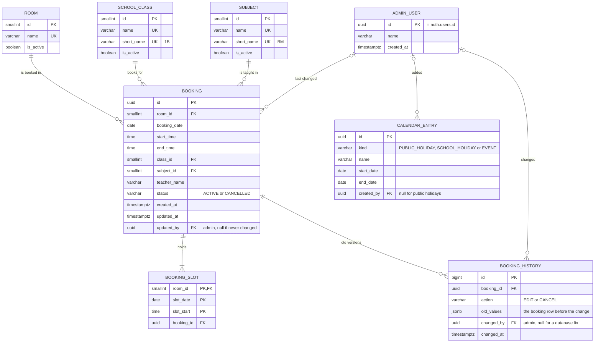

# Database design — MITSPI Room Booking

Plan for Supabase (PostgreSQL), decided 21 Oct 2026. Access rules: RLS and database functions (section 5).
Architecture and flows: [architecture.md](architecture.md).

## 1. Entity diagram



## 2. Tables

| Table | One row is | Notes |
|---|---|---|
| `room` | A room that can be booked | `is_active = false` hides it from new bookings but keeps old ones |
| `school_class` | A class, for example 1 Al Biruni (short form 1B) | `class` is a keyword in JavaScript, so the table is `school_class` |
| `subject` | A subject, for example Bahasa Melayu (short form BM) | The admin keeps both lists on "School lists" |
| `booking` | One booking: room, date, start–end, class, subject, teacher | The teacher's name is free text, because teachers do not log in |
| `booking_slot` | One 30-minute slot that a booking holds | Its primary key stops double booking (section 3) |
| `booking_history` | One admin edit or cancel of a booking, with the old values | A trigger writes it (section 5). Nobody can change or delete a row through the API. |
| `admin_user` | A Supabase Auth user who is an admin | Supabase Auth keeps the email and password hash. This table only says "this user is an admin". |
| `calendar_entry` | A public holiday, school holiday or event, one day or a range | Information only: no booking depends on it. A refresh replaces the `PUBLIC_HOLIDAY` rows in one transaction. |

Why lookup tables (`room`, `school_class`, `subject`) and not text?
The dashboard filters by them, and a rename changes one row, not every booking.

Starting data: the school's 10 classes and 25 subjects with short forms (20 Oct 2026)
and the 2 rooms (Makmal Komputer 1 and 2), as in `DEFAULT_LISTS` in `src/data/school.ts`.

## 3. How double booking is stopped

A booking from 8:00 to 9:30 in Makmal Komputer 1 writes 3 rows in `booking_slot`:

| room_id | slot_date | slot_start | booking_id |
|---|---|---|---|
| 1 | 2026-10-21 | 08:00 | b1… |
| 1 | 2026-10-21 | 08:30 | b1… |
| 1 | 2026-10-21 | 09:00 | b1… |

The primary key is `(room_id, slot_date, slot_start)`.
A second booking that touches 08:30 in Makmal Komputer 1 fails with a unique violation.
The Edge Function turns that into "This time was just taken". This works even when two requests arrive at the same time.

- **Edit time:** in one transaction, delete the old slot rows and insert the new ones.
- **Remove:** set `status = 'CANCELLED'` and delete the slot rows. The booking stays for reports.

Alternative: one `EXCLUDE USING gist` constraint on a time range in `booking`.
It is shorter, but harder to read.

## 4. Tables (SQL for the Supabase SQL editor)

```sql
CREATE TABLE room (
  id        SMALLSERIAL PRIMARY KEY,
  name      VARCHAR(50) NOT NULL UNIQUE,
  is_active BOOLEAN     NOT NULL DEFAULT TRUE
);

CREATE TABLE school_class (
  id         SMALLSERIAL PRIMARY KEY,
  name       VARCHAR(50) NOT NULL UNIQUE,
  short_name VARCHAR(10) NOT NULL UNIQUE,   -- 1B, saved in capitals
  is_active  BOOLEAN     NOT NULL DEFAULT TRUE
);

CREATE TABLE subject (
  id         SMALLSERIAL PRIMARY KEY,
  name       VARCHAR(50) NOT NULL UNIQUE,
  short_name VARCHAR(10) NOT NULL UNIQUE,   -- BM, saved in capitals
  is_active  BOOLEAN     NOT NULL DEFAULT TRUE
);

-- Made by hand: create the user in Supabase Auth, then insert its id here.
CREATE TABLE admin_user (
  id         UUID        PRIMARY KEY REFERENCES auth.users(id) ON DELETE CASCADE,
  name       VARCHAR(80) NOT NULL,
  created_at TIMESTAMPTZ NOT NULL DEFAULT now()
);

CREATE TABLE booking (
  id           UUID         PRIMARY KEY DEFAULT gen_random_uuid(),
  room_id      SMALLINT     NOT NULL REFERENCES room(id),
  booking_date DATE         NOT NULL,
  start_time   TIME         NOT NULL,
  end_time     TIME         NOT NULL,
  class_id     SMALLINT     NOT NULL REFERENCES school_class(id),
  subject_id   SMALLINT     NOT NULL REFERENCES subject(id),
  teacher_name VARCHAR(80)  NOT NULL,
  status       VARCHAR(10)  NOT NULL DEFAULT 'ACTIVE' CHECK (status IN ('ACTIVE', 'CANCELLED')),
  created_at   TIMESTAMPTZ  NOT NULL DEFAULT now(),
  updated_at   TIMESTAMPTZ  NOT NULL DEFAULT now(),
  updated_by   UUID         REFERENCES admin_user(id),
  CHECK (start_time >= '07:30' AND end_time <= '18:30' AND end_time > start_time)
);

-- Dashboard filters by month first.
CREATE INDEX booking_date_idx ON booking (booking_date);

CREATE TABLE booking_slot (
  room_id    SMALLINT NOT NULL REFERENCES room(id),
  slot_date  DATE     NOT NULL,
  slot_start TIME     NOT NULL,
  booking_id UUID     NOT NULL REFERENCES booking(id) ON DELETE CASCADE,
  PRIMARY KEY (room_id, slot_date, slot_start)     -- no double booking
);

-- Audit trail: the old booking row on each edit or cancel.
CREATE TABLE booking_history (
  id         BIGSERIAL   PRIMARY KEY,
  booking_id UUID        NOT NULL REFERENCES booking(id),
  action     VARCHAR(10) NOT NULL CHECK (action IN ('EDIT', 'CANCEL')),
  old_values JSONB       NOT NULL,
  changed_by UUID        REFERENCES admin_user(id),   -- null for a fix in the SQL editor
  changed_at TIMESTAMPTZ NOT NULL DEFAULT now()
);

CREATE INDEX booking_history_booking_idx ON booking_history (booking_id);

CREATE TABLE calendar_entry (
  id         UUID        PRIMARY KEY DEFAULT gen_random_uuid(),
  kind       VARCHAR(20) NOT NULL CHECK (kind IN ('PUBLIC_HOLIDAY', 'SCHOOL_HOLIDAY', 'EVENT')),
  name       VARCHAR(80) NOT NULL,
  start_date DATE        NOT NULL,
  end_date   DATE        NOT NULL,
  created_by UUID        REFERENCES admin_user(id),   -- null for public holidays from the feed
  CHECK (end_date >= start_date)
);

-- The booking page asks "what is on this day?"
CREATE INDEX calendar_entry_dates_idx ON calendar_entry (start_date, end_date);
```

The 30-minute rule (start on :00 or :30) and the abuse limits are checked in `create_booking` (section 5).

## 5. Access rules: RLS and functions

RLS is on for every table. A table with RLS and no matching policy refuses the request.
Teachers use the public anon key; the admin is an `authenticated` user listed in `admin_user`.

```sql
ALTER TABLE room           ENABLE ROW LEVEL SECURITY;
ALTER TABLE school_class   ENABLE ROW LEVEL SECURITY;
ALTER TABLE subject        ENABLE ROW LEVEL SECURITY;
ALTER TABLE admin_user     ENABLE ROW LEVEL SECURITY;
ALTER TABLE booking        ENABLE ROW LEVEL SECURITY;
ALTER TABLE booking_slot   ENABLE ROW LEVEL SECURITY;
ALTER TABLE booking_history ENABLE ROW LEVEL SECURITY;
ALTER TABLE calendar_entry ENABLE ROW LEVEL SECURITY;

-- True when the signed-in user is an admin.
CREATE FUNCTION is_admin() RETURNS boolean
LANGUAGE sql STABLE SECURITY DEFINER SET search_path = public AS $$
  SELECT EXISTS (SELECT 1 FROM admin_user WHERE id = auth.uid())
$$;

-- Lists and calendar: everyone reads, the admin writes. No DELETE policy on the lists (hide, not delete).
CREATE POLICY read_all ON room FOR SELECT TO anon, authenticated USING (true);
CREATE POLICY admin_add ON room FOR INSERT TO authenticated WITH CHECK (is_admin());
CREATE POLICY admin_change ON room FOR UPDATE TO authenticated USING (is_admin()) WITH CHECK (is_admin());
-- Same three policies for school_class and subject.

CREATE POLICY read_all ON calendar_entry FOR SELECT TO anon, authenticated USING (true);
CREATE POLICY admin_all ON calendar_entry FOR ALL TO authenticated USING (is_admin()) WITH CHECK (is_admin());

-- Bookings: only the admin reads them directly. Nobody writes them directly: the functions below do.
CREATE POLICY admin_read ON booking FOR SELECT TO authenticated USING (is_admin());
CREATE POLICY own_row ON admin_user FOR SELECT TO authenticated USING (id = auth.uid());
-- booking_slot: no policy. Only the functions use it.

-- History: the admin reads it. No INSERT, UPDATE or DELETE policy: only the trigger writes it.
CREATE POLICY admin_read ON booking_history FOR SELECT TO authenticated USING (is_admin());

-- Keeps the old row on every booking change, also on a fix in the SQL editor.
CREATE FUNCTION log_booking_change() RETURNS trigger
LANGUAGE plpgsql SECURITY DEFINER SET search_path = public AS $$
BEGIN
  INSERT INTO booking_history (booking_id, action, old_values, changed_by)
  VALUES (
    OLD.id,
    CASE WHEN NEW.status = 'CANCELLED' AND OLD.status = 'ACTIVE' THEN 'CANCEL' ELSE 'EDIT' END,
    to_jsonb(OLD),
    auth.uid()
  );
  RETURN NEW;
END;
$$;

CREATE TRIGGER booking_history_trg
AFTER UPDATE ON booking
FOR EACH ROW EXECUTE FUNCTION log_booking_change();
```

| Function | Who may call it | Does |
|---|---|---|
| `availability(room_id, date)` | anon, authenticated | Active bookings of that room and day: start, end, class, subject, teacher name. No other column. |
| `create_booking(...)` | **service_role only** (the `create-booking` Edge Function, after Turnstile) | Checks the input and limits, inserts the booking and its slots in one transaction |
| `update_booking(id, ...)` | authenticated; first line checks `is_admin()` | Refuses a started booking. Deletes the old slots, inserts the new ones. Sets `updated_by`, `updated_at`. |
| `cancel_booking(id)` | authenticated; first line checks `is_admin()` | Refuses a started booking. Sets `status = 'CANCELLED'`, deletes the slots. |
| `replace_public_holidays(rows)` | service_role only (`refresh-holidays` Edge Function) | Deletes and inserts the `PUBLIC_HOLIDAY` rows in one transaction |

Every function is `SECURITY DEFINER SET search_path = public`, so it can write tables that the caller cannot.
`REVOKE EXECUTE ... FROM public` first, then `GRANT EXECUTE` only to the roles in the table.

Sketch of `create_booking` (the important checks):

```sql
CREATE FUNCTION create_booking(
  p_room_id SMALLINT, p_date DATE, p_start TIME, p_end TIME,
  p_class_id SMALLINT, p_subject_id SMALLINT, p_teacher_name TEXT
) RETURNS uuid
LANGUAGE plpgsql SECURITY DEFINER SET search_path = public AS $$
DECLARE
  v_id   uuid;
  v_name text := trim(p_teacher_name);
BEGIN
  IF length(v_name) NOT BETWEEN 1 AND 80 THEN RAISE EXCEPTION 'bad_name'; END IF;
  IF extract(minute FROM p_start) NOT IN (0, 30) OR extract(minute FROM p_end) NOT IN (0, 30) THEN
    RAISE EXCEPTION 'bad_time';
  END IF;
  IF p_date + p_start < (now() AT TIME ZONE 'Asia/Kuala_Lumpur') THEN RAISE EXCEPTION 'in_past'; END IF;
  IF NOT EXISTS (SELECT 1 FROM room WHERE id = p_room_id AND is_active) THEN RAISE EXCEPTION 'bad_room'; END IF;
  -- (same check for class and subject)

  -- Abuse limits (architecture.md section 6). The numbers are a first guess.
  IF (SELECT count(*) FROM booking WHERE created_at > now() - interval '1 minute') >= 10 THEN
    RAISE EXCEPTION 'too_many';
  END IF;
  IF (SELECT coalesce(sum(end_time - start_time), '0') FROM booking
      WHERE booking_date = p_date AND status = 'ACTIVE' AND lower(teacher_name) = lower(v_name))
     + (p_end - p_start) > interval '4 hours' THEN
    RAISE EXCEPTION 'too_long';
  END IF;

  INSERT INTO booking (room_id, booking_date, start_time, end_time, class_id, subject_id, teacher_name)
  VALUES (p_room_id, p_date, p_start, p_end, p_class_id, p_subject_id, v_name)
  RETURNING id INTO v_id;

  -- One row a 30-minute slot. A taken slot raises unique_violation (23505): the whole booking is undone.
  INSERT INTO booking_slot (room_id, slot_date, slot_start, booking_id)
  SELECT p_room_id, p_date, t::time, v_id
  FROM generate_series(p_date + p_start, p_date + p_end - interval '30 minutes', interval '30 minutes') AS t;

  RETURN v_id;
END $$;

REVOKE EXECUTE ON FUNCTION create_booking FROM public, anon, authenticated;
GRANT EXECUTE ON FUNCTION create_booking TO service_role;
```

The Edge Function maps the errors to safe messages: `23505` → "This time was just taken",
`too_many` → "Busy, try again in a minute", others → "Check the booking and try again".

## 6. Main queries (supabase-js)

```ts
// Teacher page: booked times for one room and day.
supabase.rpc("availability", { room_id: roomId, date })

// Admin dashboard. Each filter is added only when it is not "All".
let query = supabase.from("booking")
  .select("*, room(name), school_class(name, short_name), subject(name, short_name)")
  .eq("status", "ACTIVE")
  .gte("booking_date", monthStart).lt("booking_date", nextMonthStart)
  .order("booking_date").order("start_time")
if (classId !== ALL) query = query.eq("class_id", classId)
```

supabase-js sends every value as a parameter. Never build SQL or filter strings from user input.

## 7. Frontend type → database

| `Booking` field (`src/features/booking/types.ts`) | Column |
|---|---|
| `id` | `booking.id` |
| `roomId` | `booking.room_id` |
| `date` (YYYY-MM-DD) | `booking.booking_date` |
| `startMinutes`, `endMinutes` | `booking.start_time`, `booking.end_time` |
| `classId` | `booking.class_id` → `school_class` |
| `subjectId` | `booking.subject_id` → `subject` |
| `teacherName` | `booking.teacher_name` |

The school lists (`src/data/school-lists.tsx`) map the same way:
`ListItem { id, name, shortName, isActive }` → one row of `room`, `school_class` or `subject`
(`shortName` → `short_name`; rooms have no short form).
